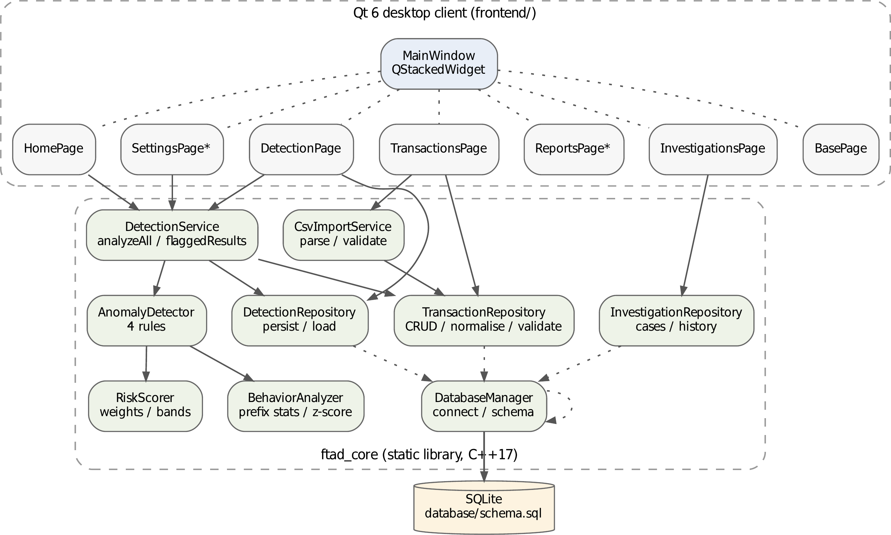

<div align="center">

# FTAD — Financial Transaction Anomaly Detector

**A C++17 / Qt 6 desktop application that flags suspicious financial
transactions with four deterministic detection rules — and opens a case
for every flagged one.**

</div>

---

<div align="center">
  
</div>

## What it actually does

FTAD imports a bank-export CSV, stores each row in SQLite, runs a
detection pass over the lot, and turns every flagged transaction into a
traceable investigation case. Nothing is asynchronous, nothing is
sampled, nothing is random: **the same database always produces the same
anomalies in the same order.**

```
CSV file ──import──▶ transactions ──detect──▶ anomalies ──case──▶ investigations
   │                   (SQLite)      4 rules      (score+level)      (status)
CsvImportService   TransactionRepo  AnomalyDetector   RiskScorer   InvestigationRepo
```

## The dataflow, as a diagram

**[FTAD - Financial Transaction Data Flow](.archify/dataflow-ftad-20261104-092149/ftad-financial-dataflow.html)**


An animated trace of the financial data: bank CSV rows become imported transactions,
the detector reads them and emits flagged anomalies, and flagged anomalies open
investigation cases — with SQLite as the persistence layer throughout.

## The detection brain

`DetectionSettings.h` holds every threshold, weight and band — all
tunable at runtime, none baked in:

| Rule | Trigger | Default | Weight |
|---|---|---|---|
| **Duplicate payment** | Same sender *and* receiver, amounts within `0.01`, timestamps ±10 min | 10 min window | **40** |
| **Large amount** | Amount above the single-transaction ceiling | `10 000` | **35** |
| **Rapid withdrawals** | ≥3 withdrawal-type transactions (`CASH_OUT`/`DEBIT`) by one sender within 60 min | 3 in 60 min | **35** |
| **Behaviour deviation** | Amount ≥3σ above the sender's own prior history (minimum 5 earlier transactions), or >2× a perfectly uniform baseline | z ≥ 3 / ratio 2.0 | **25** |

Hits are summed (capped at 100) into a risk score and banded
**low / medium / high**. Every anomaly stores its score, level, primary
method and a full human-readable reason string — an analyst reads *why*,
not just *that*. The behaviour baseline uses only transactions that
happened **before** the one under review: no future leakage, so the
result never depends on import order.

## The app in six pages

| Page | What you do there | Status |
|---|---|---|
| **Home** | Summary dashboard | done |
| **Transactions** | Browse the ledger, import CSV | done |
| **Detection** | Configure rules, run a pass, inspect flagged rows | done |
| **Investigations** | Case queue with status transitions | done |
| **Reports** | Export routines | placeholder |
| **Settings** | Persistence / preferences | placeholder |

## Project layout

```
├── main.cpp                 # 20 lines: connect DB → init schema → show window
├── backend/  (ftad_core)    # static library — zero UI deps, fully unit-tested
│   ├── include/             # AnomalyDetector, BehaviorAnalyzer, RiskScorer,
│   │                        # repositories, DetectionSettings, entities
│   └── src/                 # one .cpp per component
├── frontend/                # MainWindow + QStackedWidget pages
├── database/schema.sql      # tables, CHECKs, foreign keys, indexes
├── data/samples/            # 11-row sample CSV that exercises every rule
├── tests/                   # 154 GoogleTest cases + a benchmark, via ctest
├── analysis/                # ML evaluation of the rules vs PaySim labels
├── Reports/                 # bug / performance / testing reports
├── docs/latex/              # the full BIST4110 report (PDF + DOCX) + diagrams
└── documentation/           # QA record (15 fixed defects) & handoff notes
```

The backend is built as a **static library** so the app and the test
suite compile the sources exactly once, under identical flags
(`-Wall -Wextra`). Repositories and the detector read amounts and
flags in pure functions that never touch Qt Widgets — they only need
Qt Core/Sql, which is what made 154 offline unit tests possible without
a single database or window.

## Build and run

Requirements: **GCC ≥ 9 (C++17), CMake ≥ 3.16, Ninja, Qt 6** (Widgets,
Sql, Charts), SQLite.

```bash
cmake -B build -G Ninja
ninja -C build
./build/FTAD          # or ./run.sh
```

Point the importer at the bundled sample to see the whole pipeline fire
in one import:

```bash
data/samples/test_transactions.csv   # ACCX101 spikes to 25 000,
                                     # ACCX102 repeats a payment, ACCX103
                                     # pulls three cash-outs in 55 minutes
```

Run the test suite:

```bash
cmake -B build -G Ninja          # FTAD_BUILD_TESTS=ON by default
ninja -C build && ctest --test-dir build --output-on-failure
```

Coverage instrumentation is one flag away: `-DFTAD_ENABLE_COVERAGE=ON`.

## Quality notes (earned, not aspirational)

- **154 GoogleTest cases** across detector, analyser, scorer, import,
  repositories, settings, time handling and the full pipeline — plus a
  micro-benchmark.
- The QA record in `documentation/` documents **15 defects found and
  fixed during the official testing pass**, with each one re-verified in
  a fresh build.
- `check_docx_package.py` validates the generated report's OOXML against
  the ECMA-376 schema sequences — 0 violations.
- ML side-quest: `analysis/` scores FTAD's rules against the labelled
  **PaySim** fraud corpus (6.36 M rows) and benchmarks supervised
  models against them. Verdict so far lives in
  `documentation/model_decision.md`.

## Documentation

| Document | Where |
|---|---|
| Software Testing & Reliability report (77-page PDF, DOCX edition) | `docs/latex/` |
| UML suite — architecture, ERD, sequence, activity, class, use case | `docs/latex/figures/png/` |
| QA record: gates, compliance matrix, defect log | `documentation/qa_record.md` |
| Reports (bugs, performance, testing) | `Reports/` |

---

<div align="center">
<sub>Built as a BIST4110 Software Testing & Reliability portfolio project.
Research-grade, not production-grade — placeholders are marked as such,
and every claim above traces to a test or a measurement.</sub>
</div>
